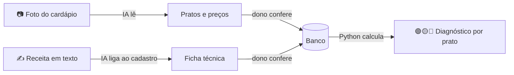

<p align="center">
  <picture>
    <source media="(prefers-color-scheme: dark)" srcset="marca/lucrafood-logo-fundo-escuro.svg">
    
  </picture>
</p>

<p align="center">
  <strong>Tire uma foto do cardápio e descubra quais pratos dão lucro e quais dão prejuízo no delivery.</strong>
</p>

<p align="center">
  Django · DRF · React · TypeScript · Gemini (visão + JSON) · Pydantic
</p>

---

## O problema

No Brasil, a maioria dos restaurantes pequenos (lanchonete, marmitaria, pizzaria de bairro) é tocada pelo próprio dono, sem contador nem planilha. O preço sai do "achismo" ou da comparação com o concorrente.

O problema aparece quando o restaurante entra no delivery. O aplicativo cobra comissão, há imposto e embalagem, e um prato que dava lucro no balcão pode estar **dando prejuízo a cada pedido**, sem que o dono perceba. Descobrir isso exige montar a ficha técnica de cada prato (quanto vai de cada ingrediente e quanto custa), e quase ninguém tem tempo para isso.

## A solução

O LucraFood usa IA para fazer a parte chata e deixa as contas para um código que não erra conta:

1. **O dono fotografa o cardápio.** A IA lê a foto e devolve os pratos com nome, categoria e preço.
2. **Ele confere o que a IA leu.** Nada é gravado sem confirmação humana.
3. **Ele conta o que vai em cada prato, em texto livre:** *"pão, hambúrguer de 150 g, 2 fatias de queijo"*. A IA liga cada item a um ingrediente cadastrado e marca o que precisa de atenção ("fatia" não tem peso exato, "queijo" pode ser três produtos diferentes).
4. **O sistema pergunta o que faltou.** *"Quanto dá mais ou menos 1 fatia de queijo prato, em gramas?"* → *"uns 18"* → anota 2 × 18 g = 36 g. A IA só entende a resposta; a conta é do sistema.
5. **Ele recebe o diagnóstico de cada prato:** custo, margem no balcão, margem no delivery e um semáforo 🟢 🟡 🔴, com o preço sugerido para voltar à margem desejada.

O painel guia o primeiro acesso passo a passo (cadastrar ingredientes, montar as fichas, ajustar taxas) até o restaurante ter o diagnóstico do cardápio inteiro.



## Como a IA é usada (e onde ela não entra)

O princípio do projeto é **a IA lê e conversa; ela nunca faz conta.** Modelos de linguagem erram aritmética, e um preço errado custa dinheiro ao restaurante. Por isso:

| Tarefa | Quem faz |
|---|---|
| Ler a foto do cardápio (inclusive preço escrito à mão) | IA (modelo de visão, saída JSON) |
| Entender "meio quilo de batata" e ligar "hambúrguer" a "Blend bovino" | IA (texto → JSON, com o cadastro do restaurante no contexto) |
| Entender a resposta do dono na conversa ("cada fatia uns 18 gramas") | IA (só número e unidade, como foram ditos) |
| Escolher a pergunta e calcular 2 fatias × 18 g = 36 g | Python |
| Converter kg → g, conferir se o ingrediente existe, decidir o que o dono precisa revisar | Python |
| Custo, margem, semáforo, preço sugerido | Python puro com `Decimal` ([`calculos.py`](backend/cardapio/calculos.py)) |

Outras decisões que tornam a IA confiável:

- **Saída estruturada e validada.** Toda resposta passa por Pydantic. Se vier inválida, o erro volta para o modelo numa segunda tentativa; se falhar de novo, o usuário vê um erro claro em vez de dados inventados.
- **Sem chute.** Preço ilegível vira vazio, não um palpite. Um id de ingrediente que não existe no cadastro é descartado pelo Python. "2 fatias" não vira gramas: o dono informa.
- **Ela marca o que tem dúvida.** Cada item da ficha volta com os motivos de revisão (sinônimo ou erro de digitação, medida caseira, unidade incompatível, ingrediente repetido). A tela destaca esses itens em dois níveis, "confira" e "preencha", para o dono não se acostumar a ignorar aviso.
- **Provedor trocável.** A integração usa a biblioteca `openai` com a API compatível do provedor: Gemini por padrão, Groq como alternativa. Trocar de modelo é uma variável de ambiente.
- **Erros do provedor tratados.** Limite de taxa (429) espera e tenta de novo; sobrecarga (503) tenta com espera crescente; foto ilegível vira um pedido de outra foto, não uma lista vazia.

## Resultados medidos

Em vez de "parece que funciona", a IA é avaliada com dados reais e gabarito, por comandos que chamam a API de verdade e guardam a saída de cada rodada.

| O que foi medido | Conjunto | Resultado |
|---|---|---|
| Leitura de cardápio por foto | 8 cardápios reais, 254 pratos (inclusive preço escrito à mão) | **251 de 254 pratos, 251 de 251 preços** (~5 s por foto) |
| Foto tirada no celular | cardápio fotografado na tela, 17 pratos | 17 de 17 pratos e preços |
| Ficha técnica por texto | 10 frases com sinônimos, kg/litro, medidas caseiras, erro de digitação | **42 de 42 ingredientes e quantidades, em 5 rodadas seguidas** |
| Pedido de conferência ao dono | 7 frases ambíguas de propósito | 21 de 21 itens |
| Leitura das respostas na conversa | 14 respostas ("uns 2 quilos", "trezentos e cinquenta gramas", "pula essa") | 13 de 14 |

A avaliação também orientou decisões de produto. Ela mostrou que o plano gratuito do Groq corta cardápios grandes (troquei para o Gemini) e que recomprimir a foto em JPEG no navegador faz o modelo errar dígitos escritos à mão (o app só recomprime quando precisa). O histórico completo, com cada rodada e o que mudou entre elas, está em [docs/AVALIACAO.md](docs/AVALIACAO.md).

## Stack

| Camada | Tecnologias |
|---|---|
| Backend | Python, Django 5.2, Django REST Framework, SQLite |
| Frontend | React 19, TypeScript, Vite, React Router, mobile-first (câmera do celular) |
| IA | Gemini 3.5 Flash-Lite (visão + JSON) pela biblioteca `openai`; Groq como alternativa; Pydantic para validar a saída |
| Qualidade | 164 testes no backend (IA simulada, sem rede), 43 no frontend (Vitest), conjuntos de avaliação com fotos e frases reais |

## Arquitetura

```
backend/cardapio/
├── calculos.py        toda a matemática (custo, margem, semáforo, preço sugerido), sem Django e sem IA
├── ia/
│   ├── cliente.py     provedor configurável (Gemini/Groq) e limites do plano gratuito
│   ├── extracao.py    foto → pratos (JSON validado, nova tentativa, tratamento de 429/503)
│   ├── ficha.py       texto → itens da ficha, conferidos e convertidos pelo Python
│   └── conversa.py    pergunta o que faltou; a IA lê a resposta, o Python faz a conta
├── views*.py          API REST em duas etapas: a IA lê, o dono confirma, só então grava
└── avaliacao*.py      comparação com o gabarito (testada sem API)

frontend/src/telas/    Foto → Revisão → Painel → Prato (ficha) · Ingredientes · Ajustes
evals/                 fotos de cardápio e frases com gabarito + saídas de cada rodada
```

## Status e próximos passos

- [x] Extração do cardápio por foto, com revisão antes de salvar
- [x] Motor de custo, margem, semáforo e preço sugerido (com testes)
- [x] Ficha técnica: ingredientes, ficha à mão e por texto com revisão, rendimento da receita
- [x] Frontend completo, com fluxo guiado para o primeiro acesso
- [x] Conjuntos de avaliação com fotos e frases reais
- [x] Ficha em conversa: o sistema pergunta o que faltou ("quanto dá 1 fatia de queijo?") e anota a resposta
- [ ] Lembrar as medidas do restaurante ("1 fatia de queijo prato = 18 g") para não perguntar de novo
- [ ] Simulador de preço ("e se eu cobrar R$ 2 a mais?")
- [ ] Teste com restaurantes de verdade

## Autor

Desenvolvido por **Marcus Vinicius** ([GitHub](https://github.com/MarcusVinicius44)).

Para rodar o projeto localmente, ver [docs/DESENVOLVIMENTO.md](docs/DESENVOLVIMENTO.md).
